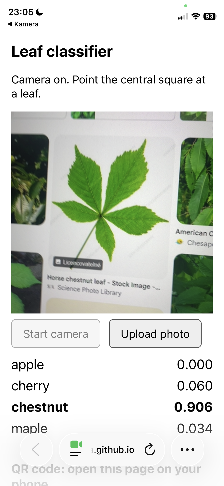

# 1. It runs on my phone

Did: opened the page in Safari on my iPhone and pointed the live camera at photos of leaves on another screen.
Found: it works. Chestnut leaf: chestnut 0.906. Maple leaves: maple 0.940.
Fixed: nothing.

# 2. The same numbers as the notebook

Did: uploaded check_image.jpg on the page in desktop Chromium and desktop WebKit.
Found: both browsers give the same numbers, and they agree with check_expected.json to three decimals.

| Class | Page | check_expected.json |
| --- | --- | --- |
| apple | 0.818 | 0.8176 |
| cherry | 0.181 | 0.1811 |
| chestnut | 0.001 | 0.0011 |
| maple | 0.000 | 0.0002 |

Fixed: nothing.

# 3. The preprocessing matches my model
Did:
- Crop to the central square and resize to 96 x 96 (index.html lines 64-66, model_info.json, notebook cell 37)
- Divide by 255, subtract mean, divide by std (index.html line 74, notebook cell 40)
- Mean and std come from model_info.json (index.html line 166 loads them, line 74 uses them; same values in notebook cell 40)
- Channel order R, G, B, channels first: (index.html lines 67 and 72-74, notebook cell 39)
- Input shape 1 x 3 x 96 x 96 (index.html line 78, notebook cell 49)

Found: every step matches model_info.json and the transform of the notebook.
Fixed: nothing.

# 4. Nothing leaves the phone

Did: logged the requests the page makes in desktop Chromium and WebKit with an uploaded photo, and in Chromium with a test camera for 5 seconds.
Found: files are downloaded only (all requests are GET). The live camera made no requests.

The page loads:
- index.html, model_info.json and leaf_model.onnx from the GitHub Pages site: the page, the preprocessing values and the model.
- ort.min.js, ort-wasm-simd-threaded.jsep.mjs and ort-wasm-simd-threaded.jsep.wasm from cdn.jsdelivr.net: ONNX Runtime Web, which runs the model in the browser.

- An uploaded photo stays in the browser temporary (a local blob: URL).
- QR code is part of the page -> no QR service used.

Fixed: the browser asked for a missing icon file -> A line added so it does not ask for it. 